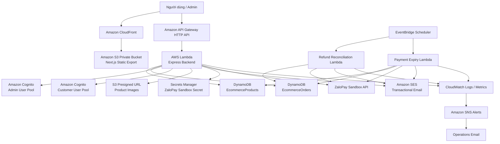

# Kiến trúc hệ thống AWS Shop

Tài liệu mô tả kiến trúc, luồng xử lý dữ liệu, bảo mật và vận hành của hệ thống AWS Shop.

---

## 1. Tổng quan

AWS Shop là web bán hàng full-stack theo kiến trúc serverless trên AWS.

Hệ thống gồm:

- Frontend Next.js static export.
- Backend Node.js/Express chạy trên AWS Lambda.
- API Gateway HTTP API.
- DynamoDB lưu sản phẩm, đơn hàng và trạng thái hoàn tiền.
- Amazon Cognito xác thực riêng cho Admin và Customer.
- Amazon S3 lưu frontend static và ảnh sản phẩm.
- Amazon CloudFront phân phối frontend.
- ZaloPay Sandbox xử lý thanh toán.
- Amazon SES gửi email giao dịch.
- EventBridge Scheduler chạy các tác vụ định kỳ.
- CloudWatch và SNS theo dõi, cảnh báo lỗi.
- GitHub Actions kiểm tra build trước khi merge/deploy.

---

## 2. Sơ đồ kiến trúc



Thành phần hệ thống

| Thành phần            | Vai trò                                  |
| --------------------- | ---------------------------------------- |
| Next.js               | Frontend cho khách hàng và Admin         |
| Amazon S3             | Lưu static frontend và ảnh sản phẩm      |
| Amazon CloudFront     | CDN phục vụ frontend HTTPS               |
| API Gateway HTTP API  | Public API endpoint cho frontend         |
| AWS Lambda            | Chạy Express backend serverless          |
| DynamoDB              | Lưu sản phẩm, đơn hàng, hoàn tiền        |
| Cognito Admin Pool    | Đăng nhập và bảo vệ API Admin            |
| Cognito Customer Pool | Đăng ký, đăng nhập khách hàng            |
| ZaloPay Sandbox       | Thanh toán và hoàn tiền test             |
| Secrets Manager       | Lưu ZaloPay App ID, Key1, Key2           |
| Amazon SES            | Gửi email đơn hàng                       |
| EventBridge Scheduler | Scheduler đối soát refund và đơn hết hạn |
| CloudWatch            | Logs, metric, alarms                     |
| SNS                   | Gửi email cảnh báo hệ thống              |
| GitHub Actions        | CI build backend, frontend và SAM        |

```
Frontend architecture

frontend/
├── src/
│   ├── app/
│   │   ├── account/
│   │   ├── admin/
│   │   ├── cart/
│   │   ├── checkout/
│   │   ├── product/
│   │   ├── products/
│   │   └── track-order/
│   │
│   ├── components/
│   │   ├── products/
│   │   ├── cart/
│   │   ├── checkout/
│   │   └── admin/
│   │
│   ├── lib/
│   └── types/
│
├── public/
├── out/
└── next.config.ts
```

Frontend deployment flow

Next.js source
|
v
npm run build
|
v
frontend/out
|
v
aws s3 sync
|
v
Private S3 Bucket
|
v
CloudFront Distribution
|
v
Browser

```
Dynamic product catalog

Frontend không phụ thuộc vào danh sách sản phẩm tại thời điểm build.

Trang chủ tải sản phẩm từ API.
Trang /products tải sản phẩm từ API.
Trang chi tiết dùng dạng:
/product?slug=ten-san-pham

Điều này cho phép Admin thêm hoặc sửa sản phẩm mà không cần build lại frontend.
```

Backend architecture

Backend chạy Express thông qua Lambda adapter.

backend/
├── src/
│ ├── jobs/
│ │ └── payment-expiry-reconciliation.job.ts
│ │
│ ├── repositories/
│ │ └── order.repository.ts
│ │
│ ├── services/
│ │ ├── order-cancellation.service.ts
│ │ ├── order-email.service.ts
│ │ └── zalopay-payment.service.ts
│ │
│ ├── types/
│ │ ├── order.ts
│ │ ├── product.ts
│ │ └── cart.ts
│ │
│ ├── lambda.ts
│ ├── server.ts
│ ├── refund-scheduler.ts
│ └── payment-expiry-scheduler.ts
│
└── package.json

```
Lambda functions

| Lambda                           | Vai trò                                                            |
| -------------------------------- | ------------------------------------------------------------------ |
| `EcommerceBackendFunction`       | API chính cho frontend, admin, checkout, product, order và payment |
| `RefundReconciliationFunction`   | Đối soát các refund ZaloPay đang xử lý                             |
| `PaymentExpirySchedulerFunction` | Hủy đơn ZaloPay hết hạn và hoàn tồn kho                            |

```

API Gateway và authentication

API Gateway HTTP API có các nhóm endpoint chính:

/{proxy+}

API public, ví dụ:

Xem sản phẩm.
Tìm kiếm sản phẩm.
Checkout.
Theo dõi đơn hàng.
Callback ZaloPay.
Query trạng thái thanh toán.
/admin/{proxy+}

API chỉ dành cho Admin.

Được bảo vệ bằng:

AdminJwtAuthorizer

Sử dụng Cognito Admin User Pool.

/account/{proxy+}

API chỉ dành cho khách hàng đã đăng nhập.

Được bảo vệ bằng:

CustomerJwtAuthorizer

Sử dụng Cognito Customer User Pool.

```
DynamoDB design

Bảng EcommerceProducts

Bảng lưu thông tin sản phẩm.

Các field quan trọng:

| Field           | Ý nghĩa                         |
| --------------- | ------------------------------- |
| `productId`     | Khóa chính sản phẩm             |
| `name`          | Tên sản phẩm                    |
| `slug`          | URL-friendly product identifier |
| `description`   | Mô tả sản phẩm                  |
| `price`         | Giá bán                         |
| `originalPrice` | Giá gốc                         |
| `stock`         | Số lượng tồn kho                |
| `category`      | Danh mục                        |
| `image`         | URL ảnh sản phẩm                |
| `createdAt`     | Thời điểm tạo                   |
| `updatedAt`     | Thời điểm cập nhật              |


Bảng EcommerceOrders

Bảng lưu đơn hàng, thanh toán, vận chuyển và hoàn tiền.

Khóa chính:

orderId

Các field quan trọng:

| Field                     | Ý nghĩa                                    |
| ------------------------- | ------------------------------------------ |
| `orderId`                 | Mã đơn hàng                                |
| `customerUserId`          | Cognito user ID của khách                  |
| `customer`                | Thông tin người nhận                       |
| `items`                   | Danh sách sản phẩm đã mua                  |
| `subtotal`                | Tổng tiền sản phẩm                         |
| `shippingFee`             | Phí giao hàng                              |
| `discount`                | Giảm giá                                   |
| `total`                   | Tổng thanh toán                            |
| `paymentMethod`           | COD, BANK_TRANSFER hoặc ZALOPAY            |
| `paymentStatus`           | PENDING hoặc PAID                          |
| `orderStatus`             | PROCESSING, SHIPPING, COMPLETED, CANCELLED |
| `statusHistory`           | Lịch sử trạng thái đơn                     |
| `shippingCarrier`         | Đơn vị vận chuyển                          |
| `shippingTrackingCode`    | Mã vận đơn                                 |
| `zalopayAppTransId`       | Mã giao dịch ZaloPay                       |
| `zalopayPaymentExpiresAt` | Thời gian hết hạn thanh toán               |
| `refundStatus`            | Trạng thái refund                          |
| `refundRequestedAt`       | Thời điểm yêu cầu refund                   |
| `createdAt`               | Thời điểm tạo                              |
| `updatedAt`               | Thời điểm cập nhật                         |

```

Global Secondary Indexes

| Index                         | Partition key          | Sort key                  | Mục đích                  |
| ----------------------------- | ---------------------- | ------------------------- | ------------------------- |
| `OrdersByCustomerIndex`       | `customerUserId`       | `createdAt`               | Lấy lịch sử đơn của khách |
| `RefundsByStatusIndex`        | `refundStatus`         | `refundRequestedAt`       | Scheduler đối soát refund |
| `PendingPaymentByExpiryIndex` | `pendingPaymentStatus` | `zalopayPaymentExpiresAt` | Tìm đơn ZaloPay hết hạn   |

```
Luồng checkout
sequenceDiagram
    participant Customer as Customer
    participant FE as Next.js Frontend
    participant API as Lambda API
    participant DB as DynamoDB
    participant ZP as ZaloPay

    Customer->>FE: Chọn sản phẩm và checkout
    FE->>API: POST /checkout
    API->>DB: DynamoDB transaction
    DB-->>API: Tạo order và trừ stock

    alt COD hoặc Bank Transfer
        API-->>FE: Tạo đơn PROCESSING
    else ZaloPay
        API->>ZP: Create payment order
        ZP-->>API: order_url + app_trans_id
        API->>DB: Lưu payment session
        API-->>FE: Redirect tới ZaloPay
    end

```

Transaction tạo đơn

DynamoDB transaction thực hiện:

Kiểm tra tồn kho.
Giảm stock từng sản phẩm.
Tạo order.
Không tạo đơn nếu stock không đủ.
Không cho tồn kho âm.

```
Luồng ZaloPay

Tạo thanh toán

PROCESSING
paymentStatus = PENDING
pendingPaymentStatus = AWAITING_PAYMENT
zalopayPaymentExpiresAt = thời gian hết hạn

Thanh toán thành công

ZaloPay callback/query
   |
   v
Xác minh dữ liệu giao dịch
   |
   v
markZaloPayOrderPaid
   |
   v
paymentStatus = PAID

Khi thanh toán thành công:

Gỡ pendingPaymentStatus.
Gỡ zalopayOrderUrl.
Gỡ zalopayPaymentExpiresAt.
Gửi email xác nhận thanh toán.

Đơn hết hạn thanh toán

EventBridge Scheduler
   |
   v
PaymentExpirySchedulerFunction
   |
   v
Query PendingPaymentByExpiryIndex
   |
   v
Kiểm tra trạng thái ZaloPay
   |
   +------------------------------+
   |                              |
   v                              v
Đã thanh toán                  Chưa thanh toán
   |                              |
   v                              v
PAID                         CANCELLED
                                  |
                                  v
                         DynamoDB transaction
                                  |
                                  v
                         Hoàn tồn kho
                                  |
                                  v
                         Gửi email hết hạn

```

Luồng trạng thái đơn hàng

Luồng hợp lệ:

PROCESSING → SHIPPING → COMPLETED
PROCESSING → CANCELLED
SHIPPING → CANCELLED

Các trạng thái không được phép:

CANCELLED → bất kỳ trạng thái khác
COMPLETED → bất kỳ trạng thái khác
PROCESSING → COMPLETED trực tiếp
SHIPPING → PROCESSING

Quy tắc ZaloPay:

ZaloPay + paymentStatus = PENDING

Không thể:

PROCESSING → SHIPPING
PROCESSING → COMPLETED

Đơn phải có:

paymentStatus = PAID

trước khi được giao hoặc hoàn tất.

```
Hoàn tiền ZaloPay

Luồng refun:

sequenceDiagram
    participant Admin
    participant API as Lambda API
    participant DB as DynamoDB
    participant ZP as ZaloPay
    participant Scheduler as EventBridge Scheduler
    participant SES as Amazon SES

    Admin->>API: Yêu cầu hoàn tiền
    API->>ZP: Create refund
    ZP-->>API: Refund request accepted
    API->>DB: refundStatus = PROCESSING

    Scheduler->>DB: Query RefundsByStatusIndex
    Scheduler->>ZP: Query refund status

    alt Refund completed
        Scheduler->>DB: refundStatus = COMPLETED
        Scheduler->>SES: Send refund completed email
    else Refund pending
        Scheduler->>DB: Giữ PROCESSING
    end

```

Upload ảnh sản phẩm

Admin upload ảnh theo luồng Presigned URL:

Admin Frontend
|
v
Request presigned URL từ API
|
v
Lambda tạo presigned URL
|
v
Frontend upload trực tiếp lên S3
|
v
CloudFront phân phối ảnh

Lợi ích:

Không gửi file lớn qua Lambda.
Giảm thời gian xử lý backend.
Giảm chi phí và timeout Lambda.
Bucket vẫn private.
CloudFront là lớp public delivery.

```
Email notifications

Amazon SES được dùng để gửi email giao dịch.

Các event chính:
| Event                 | Email                |
| --------------------- | -------------------- |
| Tạo đơn hàng          | Xác nhận đặt hàng    |
| Thanh toán thành công | Xác nhận thanh toán  |
| Cập nhật vận chuyển   | Thông tin tracking   |
| Hủy đơn               | Xác nhận hủy đơn     |
| Hoàn tiền thành công  | Xác nhận hoàn tiền   |
| ZaloPay hết hạn       | Thông báo đơn tự hủy |

Lưu ý:

Khi SES còn Sandbox, sender và recipient cần được verify.
Khi có domain, verify domain và xin SES Production Access để gửi email tới khách hàng bất kỳ.

```

Security controls

API security

CORS chỉ cho phép CloudFront domain và local development origins.
X-Content-Type-Options: nosniff.
X-Frame-Options: DENY.
Referrer-Policy.
Permissions-Policy.
Giới hạn kích thước JSON request.
Rate limit cho checkout, tracking và ZaloPay endpoints.
X-Request-Id cho việc trace request.

Authentication security

Admin và Customer sử dụng Cognito User Pool riêng.
API Admin dùng JWT authorizer.
API Customer dùng JWT authorizer.
Admin Cognito hỗ trợ TOTP MFA ở chế độ Optional.
Password policy Admin yêu cầu mật khẩu mạnh hơn Customer.

Infrastructure security

S3 bucket không public.
CloudFront dùng Origin Access Control.
S3 Versioning bật.
DynamoDB Point-in-Time Recovery bật.
ZaloPay secret lưu trong Secrets Manager.
Lambda IAM permissions được giới hạn theo resource cần dùng.
CloudFront có response headers policy.

```
Monitoring và alerting

CloudWatch

Theo dõi:

Lambda logs.
Lambda errors.
API Gateway 5xx.
Refund scheduler errors.
Payment expiry scheduler errors.
API Gateway access logs.
SNS

CloudWatch Alarm gửi thông báo qua SNS đến email vận hành.

Các alarm chính:

Backend Lambda errors
Refund scheduler Lambda errors
Payment expiry scheduler Lambda errors
API Gateway 5xx errors
EventBridge Scheduler target errors

```

CI với GitHub Actions

Workflow:

.github/workflows/ci.yml

Pipeline chạy khi:

push vào master
pull request vào master
workflow_dispatch

Các job:

Backend TypeScript build
Frontend Next.js build
SAM validate and build

CI hiện không tự deploy AWS.

Mục tiêu:

Phát hiện lỗi TypeScript.
Phát hiện lỗi frontend build.
Phát hiện lỗi SAM template.
Ngăn lỗi build trước khi deploy thủ công.

```
Hạn chế hiện tại

DynamoDB tables và GSIs vẫn được tạo ngoài SAM stack.
Rate limit ở Express/Lambda chưa phải lớp rate limit toàn cục khi Lambda scale.
Chưa có AWS WAF.
SES chưa Production Access do chưa có domain.
ZaloPay đang là Sandbox.
CI chưa tự động deploy.
Chưa có unit test hoặc integration test chính thức.

```

Roadmap kỹ thuật

Giai đoạn tiếp theo

1. Đưa DynamoDB tables và GSIs vào SAM / CloudFormation.
2. Thêm AWS WAF rate-based rules.
3. Viết unit test và integration test.
4. Tự động deploy qua GitHub Actions + AWS OIDC.
5. Mua domain và verify SES domain.
6. Xin SES Production Access.
7. Bật Admin MFA bắt buộc khi frontend hỗ trợ MFA challenge.
8. Thêm dashboard monitoring nâng cao.
